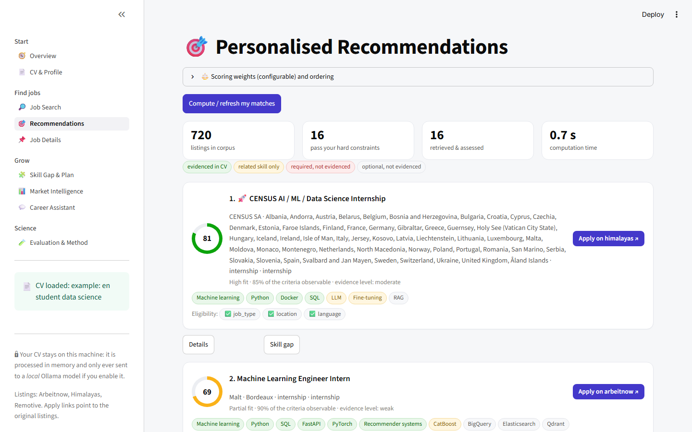
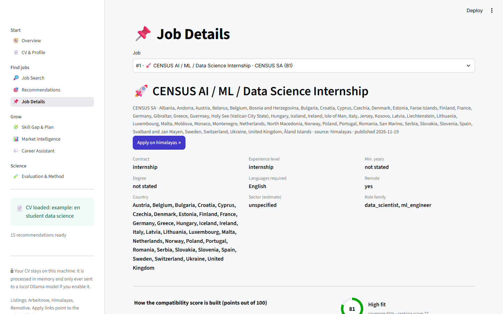
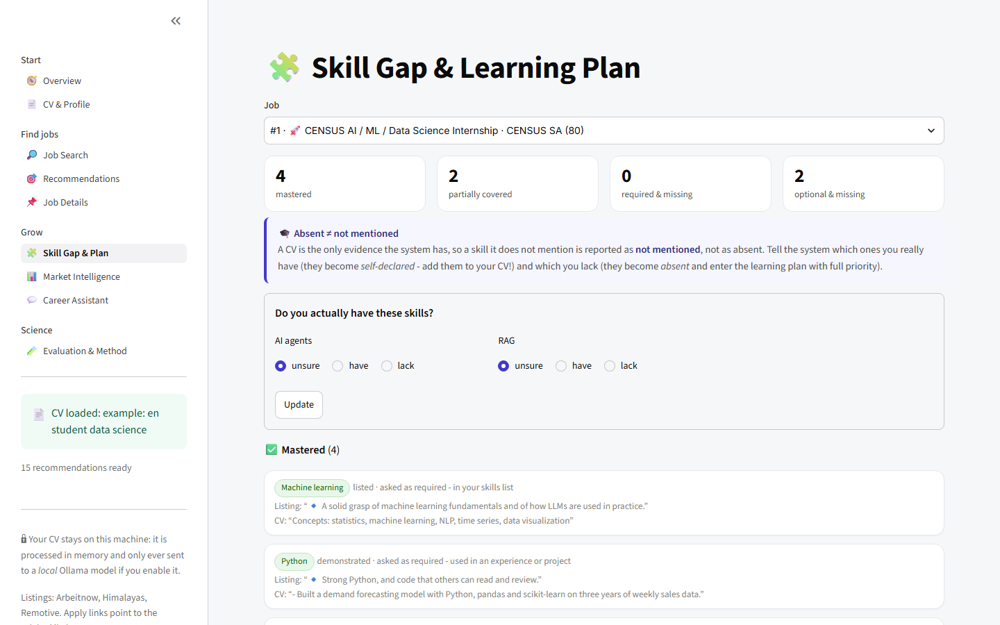
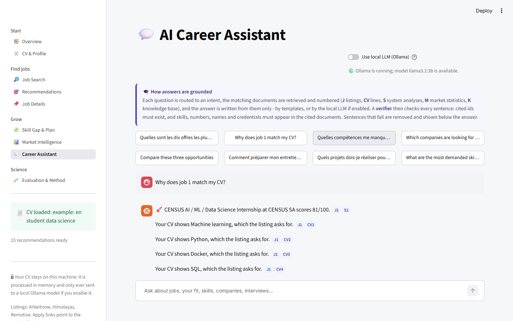
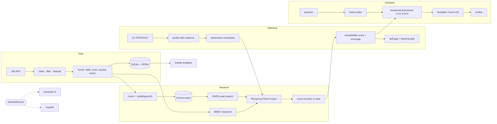

# AI-Powered Job & Internship Intelligence Assistant

**A search, matching and recommendation engine for data & AI careers — with explanations you can audit.**
Upload a CV; the system finds the real listings that fit, explains *why* with evidence from both documents, shows
what is missing and in which order to learn it, analyses the job market, and answers questions through a RAG
assistant whose every sentence cites its sources and passes a verifier. The LLM is one optional, local component —
not the system.

[](https://github.com/iliass-Ait-Ali/job-intelligence-assistant/actions/workflows/ci.yml)
  

| Ranked recommendations with an interpretable score | Score decomposition and evidence |
|---|---|
|  |  |
| **Skill gap and prerequisite-ordered learning plan** | **Grounded assistant: every sentence cites documents** |
|  |  |

📘 **Learn the project** (French course, 10 chapters): [`docs/learn/`](docs/learn/00_sommaire.md) ·
🖼️ **Illustrated walkthrough**: [`docs/RAPPORT_PEDAGOGIQUE.md`](docs/RAPPORT_PEDAGOGIQUE.md) ·
📊 **Results**: [`reports/evaluation_report.md`](reports/evaluation_report.md) ·
🎤 [`INTERVIEW_GUIDE.md`](INTERVIEW_GUIDE.md)

---

## What it does

| Module | Highlights | Code |
|---|---|---|
| 1 · Data collection & processing | Arbeitnow, Himalayas, Remotive public APIs (terms respected, original links kept); cached raw snapshots; cleaning, relevance filter, deduplication; **structured postings** (required / preferred skills with evidence, soft skills, level, years, degree, languages, country, sector) validated with Pydantic; **SQLite** store; data-quality report | `connectors/` `pipeline.py` `enrich/` |
| 2 · CV parsing | PDF / **DOCX** / text; sections in EN/FR/DE; dated experience → duration *bounds*; education, projects, skills (demonstrated vs listed), languages, certifications, sectors; ~150-skill taxonomy with aliases, **directional implications** (PostgreSQL ⇒ SQL, not the reverse) and related groups | `match/cv_*.py` `match/taxonomy.py` |
| 3 · Hybrid search | **keyword baseline**, **BM25** (own implementation), **dense** multilingual-e5 embeddings searched exactly with **FAISS**, **Reciprocal Rank Fusion**, **cross-encoder** re-ranking; filters applied before ranking | `search/` |
| 4 · Matching & recommendation | eliminatory constraints first (*unknown never excludes*, exclusions listed with reasons); multi-query retrieval from the CV; **interpretable 0-100 compatibility index** over observable criteria + coverage; configurable weights; calibration experiment (leave-one-candidate-out) | `match/matcher.py` `match/scoring.py` `config/scoring.yaml` |
| 5 · Skill gap | mastered / implied / transferable / self-declared / **not mentioned vs absent** (asks the user); priority = level × fit × market demand; **topological sort** of prerequisites; resources, portfolio projects, interview questions | `match/gap.py` `knowledge/skills_kb.yaml` |
| 6 · Market intelligence | skill demand by segment, required-only view, countries, sectors, companies, **co-occurrence (P(B∣A), lift)**, role-family **distinctiveness**, weekly trend, snapshot comparison | `market/analytics.py` |
| 7 · RAG assistant | rule-based intent router (EN/FR); numbered documents (listings, CV lines, system analyses, market statistics, knowledge base); deterministic or **local LLM** (Ollama) answers; **sentence-level verifier**; prompt-injection defences | `assistant/` `rag/` |
| 8 · Interfaces | **Streamlit** app (9 pages) · **FastAPI** REST API with OpenAPI docs · CLI `jobintel` | `ui/` `api/` |

## Architecture



The UI and the API call the **same service layer** (`services.py`), which owns the shared models and indexes;
domain modules never depend on an interface. Details: [docs/learn/09_architecture.md](docs/learn/09_architecture.md).

## Results (measured — read the caveats)

All numbers come from `jobintel bench all` → `reports/*.json` → generated [`reports/evaluation_report.md`](reports/evaluation_report.md).
**Relevance labels and gold skills were proposed by the AI assistant that built the system** (blind to system
outputs, written rubrics), not by humans: treat them as indicative. Human grades, when entered with
`jobintel label …`, automatically take precedence.

**Retrieval** — frozen corpus of 191 listings, 10 queries (FR/EN/DE, with filters), 187 pooled judgments, 95% bootstrap CI:

| System | nDCG@10 | P@5 | MAP@10 | judged@10 |
|---|---|---|---|---|
| Keyword overlap | 0.786 [0.65, 0.91] | 0.82 | 0.79 | 0.88 |
| BM25 | 0.754 [0.60, 0.89] | 0.80 | 0.74 | 0.88 |
| Dense (e5 + FAISS) | 0.798 [0.72, 0.87] | 0.78 | 0.77 | 0.94 |
| **Hybrid (RRF)** | **0.842** [0.75, 0.93] | 0.82 | 0.83 | 0.94 |
| Hybrid + cross-encoder | 0.851 [0.73, 0.94] | 0.82 | 0.83 | 0.94 |

Hybrid vs BM25: +0.088 nDCG@10, 6 wins / 1 tie / 3 losses, paired bootstrap p ≈ 0.008. The re-ranker adds little
for its cost and is optional.

**Skill extraction from listings** (dictionary + section-aware extractor): held-out test of 12 listings never used
for tuning — precision **0.91**, recall **0.70**, F1 **0.80** (dev set: 0.88 before error analysis, 0.90 after).
19% of gold skills are outside the taxonomy, the main recall limit.

**Matching** (3 synthetic CVs, nDCG@10 on labelled eligible jobs): default-weight ranking score 0.661 vs retrieval
order 0.665 — no meaningful difference on this tiny sample; weights *fitted* by random search reach 0.789 in-sample
but **0.637 out-of-sample** → over-fitting detected, documented defaults kept. Eliminatory exclusions: precision
**1.00**, recall 0.72.

**Assistant** (26 EN/FR questions, automatic metrics): routing accuracy 1.00 in both modes; with the local
`llama3.2:3b`, 98.5% of proposed citations are valid but **28% of proposed sentences fail the verifier** and are
removed (19% of answers fall back to the deterministic mode); deterministic answers: 98.8% pass. No salary /
probability / hiring-guarantee claim reached a user. Median latency 0.09 s (deterministic) vs 8.2 s (LLM).

**Latency** (RTX 4060, 720 listings, warm): BM25 19 ms · dense 34 ms · hybrid 71 ms · hybrid + cross-encoder
0.74 s · full recommendations 0.92 s. FAISS exact search 1.0 ms vs Chroma HNSW 6.6 ms per query (HNSW recall@10 =
1.0 at this scale). Details: [`reports/evaluation_report.md`](reports/evaluation_report.md) §4–5.

## Quick start

```powershell
git clone https://github.com/iliass-Ait-Ali/job-intelligence-assistant.git
cd job-intelligence-assistant
python -m venv .venv ; .\.venv\Scripts\Activate.ps1        # Linux/macOS: source .venv/bin/activate
pip install -e ".[app,dev]"           # for a GPU, install the matching CUDA build of torch first

jobintel collect                      # fetch listings from the public APIs (polite, cached)
jobintel enrich                       # structured postings + SQLite + quality report
jobintel index                        # embeddings (GPU used automatically if available)
jobintel ui                           # http://127.0.0.1:8501
jobintel api                          # http://127.0.0.1:8000/docs
pytest -q                             # 530+ offline tests (no network, no model download)
jobintel bench all                    # re-run every benchmark and regenerate the report
```

Optional local LLM: install [Ollama](https://ollama.com), `ollama pull llama3.2:3b`, `jobintel llm-status`.

**Docker**

```bash
docker compose run --rm pipeline      # collect + enrich + index into ./data
docker compose up -d api ui           # API :8000/docs · UI :8501 (bound to 127.0.0.1)
docker compose --profile llm up -d    # optional Ollama container
```

All commands and options: [docs/USAGE.md](docs/USAGE.md).

## Engineering

* Typed Python 3.11+, Pydantic models at every boundary, central configuration (`config.py`, `.env.example`,
  `config/scoring.yaml`), explicit error types, logging, `ruff`.
* **Tests** (530+, ~1 min, offline): unit (metrics checked against hand calculations, BM25, RRF, parser, score,
  topological sort, router), integration (real Chroma + FAISS on synthetic data, FastAPI `TestClient`, mock Ollama
  server), end-to-end (every Streamlit page through `AppTest`, a recommendations → gap → chat journey, and a Playwright
  script that drives the running app and takes the screenshots).
* **CI** (GitHub Actions): lint, tests on 3.11 / 3.12, Docker build. **Docker**: multi-stage, CPU PyTorch,
  non-root user, health check; data and models are volumes.
* **Reproducibility**: frozen evaluation corpus, fixed seeds, benchmarks write JSON, the report is generated.

## Privacy & data

* CVs are processed in memory; temporary upload files are deleted; no contact details are extracted; nothing is stored.
* The LLM client refuses any non-local server (a private host can be trusted explicitly by the operator, e.g. the
  compose `ollama` service). CVs are never sent to an external service.
* Listings belong to their sources: `data/` is git-ignored and recreated with `jobintel collect`; apply links point
  to the original listings. Attribution: jobs courtesy of [Arbeitnow](https://www.arbeitnow.com),
  [Himalayas](https://himalayas.app) and [Remotive](https://remotive.com).

## Limitations

AI-proposed labels; small evaluation sets (10 queries, 3 synthetic CVs, 32 annotated listings, 26 assistant
questions); rule-based parser and finite taxonomy; weak sector heuristic (shown as an estimate); a three-board
sample that is remote- and US-heavy, not the labour market; a small local LLM. Next steps: human annotation with
inter-annotator agreement, LLM-proposed skills behind the same verifier, learning-to-rank once interaction data exist.

## Repository map

```
src/job_intel/
  connectors/ pipeline.py http.py storage.py dedup.py relevance.py   data collection (Module 1)
  enrich/        structured postings, sector heuristic, SQLite store
  search/        keyword, BM25, embeddings, Chroma store, FAISS, RRF, cross-encoder, filters
  match/         CV text + parser, taxonomy, soft skills, requirements, matcher, scoring, skill gap
  knowledge/     learning resources, prerequisites, interview questions (YAML)
  market/        market analytics
  assistant/     intent router, cited answers, verification     rag/  evidence packs, explanations, Ollama client
  evaluation/    metrics, retrieval / skills / scoring / assistant / latency benchmarks, report
  services.py    shared service layer          api/  FastAPI          ui/  Streamlit (9 pages)
config/  scoring weights      eval/  queries, synthetic CVs, assistant questions      reports/  benchmark outputs
docs/    learn/ (French course), RAPPORT_PEDAGOGIQUE.md, USAGE.md, LABELING_GUIDE.md, screenshots/
notebooks/  01_exploration.ipynb, 02_evaluation.ipynb      scripts/  screenshots, notebooks, link check, bench
tests/   530+ offline tests
```

License: MIT (code). Job listings are third-party content and are not redistributed.
