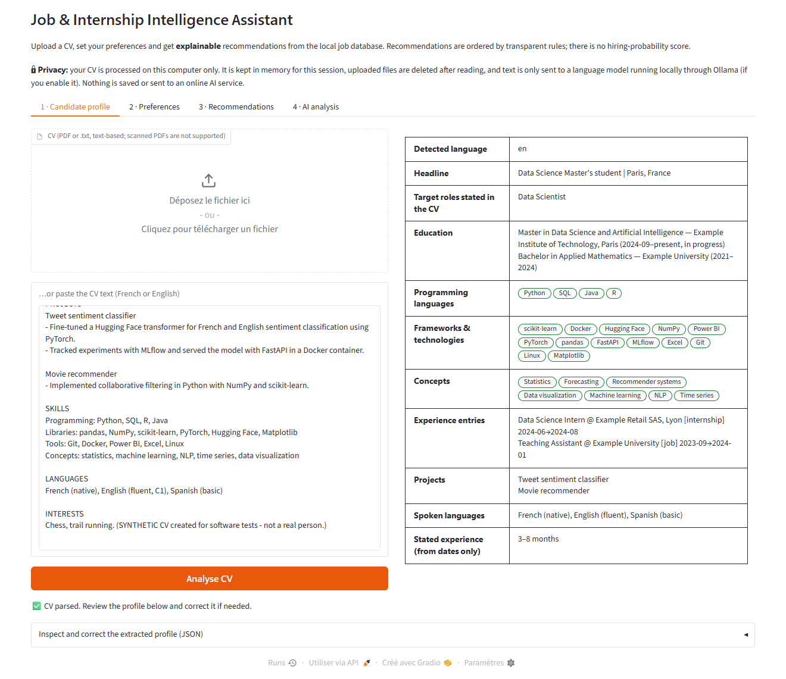
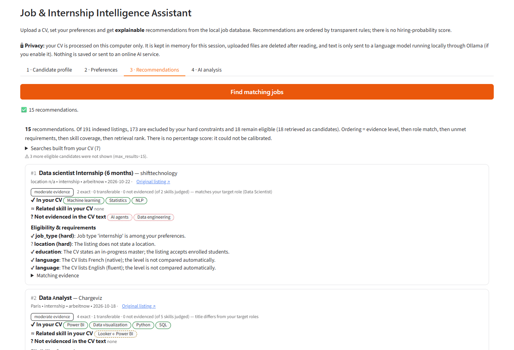
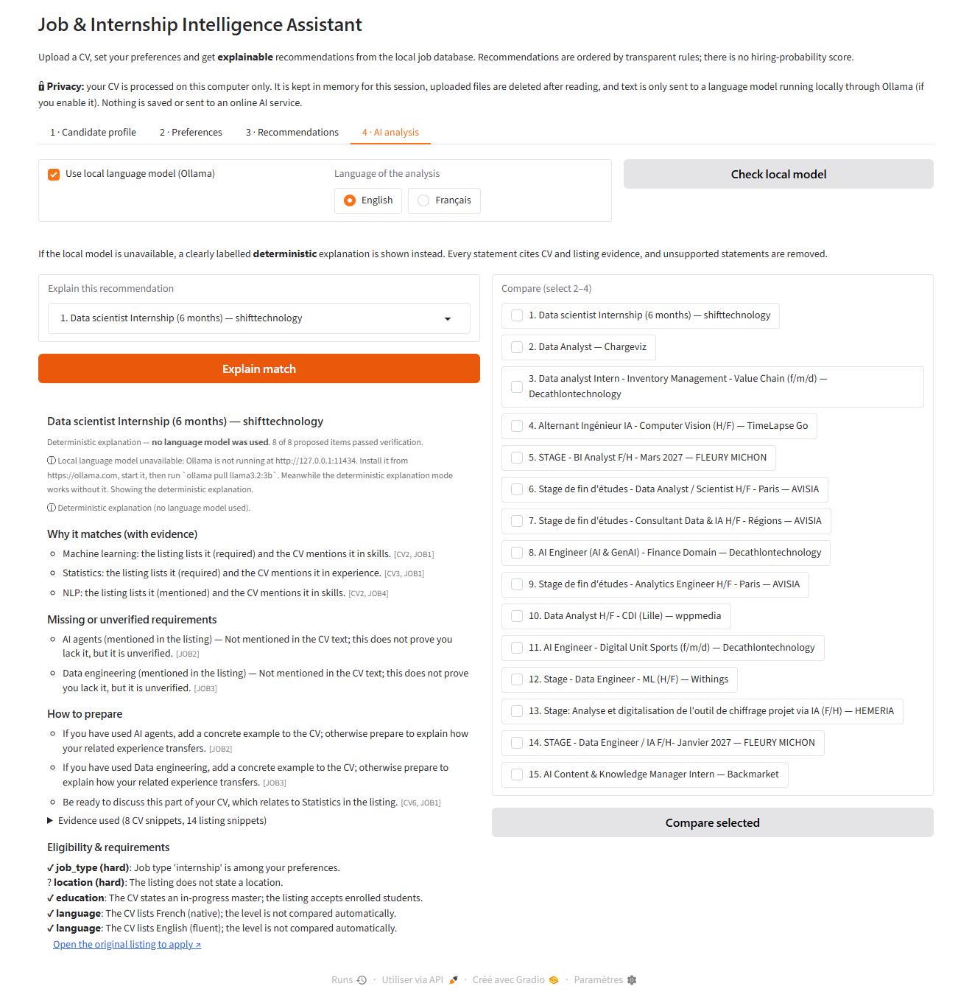
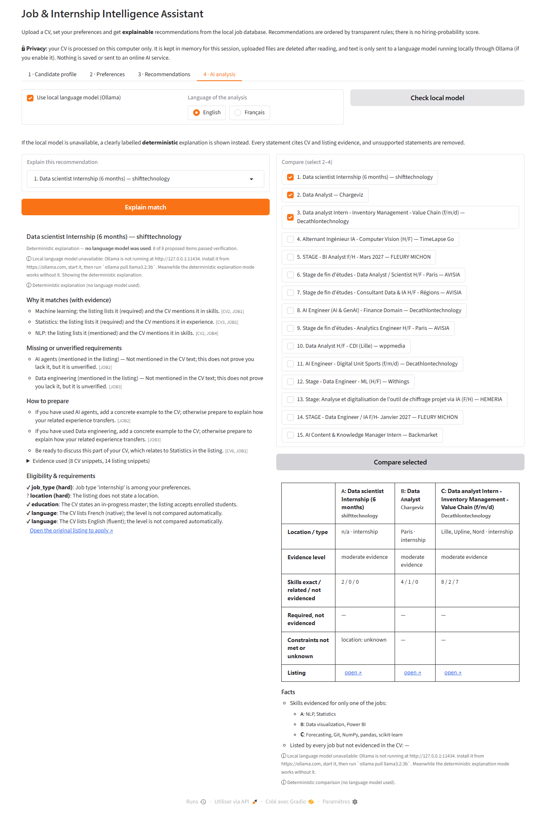
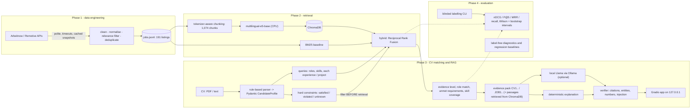

# AI-Powered Job & Internship Intelligence Assistant

A local, privacy-preserving application that **collects real job listings, searches them semantically (French, English, German),
matches them to a candidate's CV, and explains every recommendation with evidence taken from the CV and the listing**.
It is built to be *evaluated*: every quality claim in this README is either measured (and shown with its caveats) or explicitly
marked as **not yet measured**.

> **Status.** Pipeline, retrieval (BM25, semantic, hybrid), CV matching, grounded explanations and the Gradio app are implemented
> and covered by 476 offline tests. Retrieval and matching *quality* are **not yet established**: the evaluation tooling is built and
> the human judgments it needs have not been entered (see [Results](#results-what-is-measured-and-what-is-not)).

## The problem

Job boards return keyword matches and say nothing about *why* a listing fits a person. A candidate with a data-science CV
searching in French and English misses relevant roles (vocabulary and language gaps), cannot tell hard requirements from
nice-to-haves, and gets no signal about what is missing. This project explores a transparent alternative that a recruiter
or hiring manager could audit:

* retrieval that handles multilingual queries (semantic + lexical, fused);
* matching with **explicit, inspectable rules** (exact vs transferable vs unverified skills, hard constraints vs preferences,
  *unknown is never a mismatch*) instead of an opaque "87% match" score;
* explanations in which **every statement cites a CV line and a listing line**, checked by a verifier before display;
* everything running **locally** (CVs never leave the machine).

## What it looks like

| Profile extracted from a CV (synthetic) | Ranked recommendations with evidence |
|---|---|
|  |  |

| Grounded explanation (deterministic mode, Ollama not running) | Side-by-side comparison |
|---|---|
|  |  |

Screenshots use a **synthetic** CV (`eval/synthetic_cvs`) and show real Arbeitnow listings with their original links.
Regenerate them with `python scripts/capture_screenshots.py`.

## Architecture



### Stack

| Layer | Choice | Why |
|---|---|---|
| Language / packaging | Python 3.11+, `pyproject.toml`, optional extras (`search`, `app`) | Phase 1 installs with two dependencies only |
| Ingestion | `requests`, own retry/backoff/pacing client, gzip raw snapshots | polite to the providers, reproducible reruns |
| Embeddings | `intfloat/multilingual-e5-base` (SentenceTransformers, CPU) | multilingual, query/passage prefixes, MIT license |
| Vector store | ChromaDB (persistent, cosine) | local, metadata filters, simple to inspect |
| Lexical baseline | in-house BM25 (no dependency) | a baseline you can read in 60 lines |
| CV parsing | `pypdf` + rule-based parser + Pydantic models | deterministic, testable, no CV text leaves the process |
| LLM (optional) | Ollama, default `llama3.2:3b`, loopback only | local; the app works without it |
| UI | Gradio, bound to 127.0.0.1, analytics off | |
| Tests | pytest, real ChromaDB on synthetic fixtures, mock Ollama HTTP server | no network, no model download |

## Data provenance and limits

* **Source:** the public Arbeitnow API (and Remotive, which currently returns a 9-job sample with no relevant role). Listings keep their
  original URL and source name; Remotive listings may not be passed to third-party aggregators.
* **Snapshot:** 2,915 listings fetched on 2026-10-23, 193 relevant (title-based filter for data / ML / AI roles and data-flavoured
  internships), 2 near-duplicates removed, **191 kept**, published 2026-10-16 to 2026-10-23, 118 companies. Languages (rough heuristic):
  about 127 English, 28 French, 19 German, 17 Dutch.
* **Known gaps:** 47 listings (25%) state no job type, only 14 say "remote", 8 have no location, and several postings are the same role
  repeated per city (so top results can be clusters). The job data and the vector index are **git-ignored** (they are third-party content).

## Method

**Retrieval.** Descriptions (median 1,300 tokens) are split into <=300-token chunks that each start with a `title | company | location | type`
header; token counts use the model's own tokenizer and over-length chunks are an error, never a silent truncation. A job's semantic score is
its best chunk's cosine similarity. Search over-fetches chunks until `k` distinct jobs are covered (so one long posting cannot crowd out
others) and applies metadata filters *before* the vector search. **Hybrid** = Reciprocal Rank Fusion, `1/(60+rank)`, of the full semantic and
BM25 rankings (the constant is the published default, not tuned).

**Matching.** The CV becomes a `CandidateProfile` (education, skills with the CV lines that mention them, dated experiences, projects, spoken
languages). Nothing is inferred: no proficiency, no years of experience beyond bounds computed from stated dates, no contact details.
Queries are built per role, per skill group, per experience and per project. Each retrieved job gets: *exact* / *transferable* (a related skill
from the closest related group, never counted as exact) / *not evidenced* skills against requirements extracted from the listing (with the
listing line as evidence); six constraints, each `satisfied | violated | unknown` - only a **clear violation of a constraint you marked hard**
excludes a job, and exclusions are listed with their reason; and an ordinal evidence level from documented rules. **There is no percentage
score**: it could not be calibrated, so the UI shows counts and evidence instead.

**Explanations.** Evidence pack (`CV1...`, `JOB1...`) -> deterministic template or local LLM (JSON schema, temperature 0) -> **verifier**: cited ids
must exist and be of the right kind; skills, degrees, employers/places, skill levels and numbers named in a claim must occur in the cited
text; probabilities, salaries and hiring guarantees are rejected. Failures fall back to the labelled deterministic mode.

## Evaluation methodology

* **Human judgments, never generated.** Graded 0/1/2 through a **blinded, resumable terminal tool** (`jobintel label ...`): no system
  names, ranks or scores on the card; saved after every answer. Instructions: [docs/LABELING_GUIDE.md](docs/LABELING_GUIDE.md).
* **Pooling** (top 10 of BM25, semantic and hybrid, merged and shuffled) plus **exhaustive** judging of three small queries so *true*
  recall can be computed; recall is printed only for queries whose eligible jobs are all judged, otherwise only labelled *pooled* recall.
* **Metrics:** nDCG@10 (gain 2^g-1), Precision@5 and MRR@10 at two explicit binary thresholds (grade >= 1 and >= 2), judgment coverage
  (`judged@10`), per-query tables, paired win/tie/loss counts, **bootstrap 95% intervals over queries** (n >= 5) - no significance claims.
* **CV matching audit:** ranking quality of the documented ranking vs retrieval order on the *same* eligible jobs; role-relevance and
  eligibility agreement with the human; **incorrect exclusions** (an audit sample of jobs retrieval liked but constraints excluded);
  **missing relevant jobs** (a random sample of eligible jobs outside the top 10); precision of exact vs transferable skill claims
  (all with Wilson intervals).
* **Label-free regression baselines** (`jobintel regress`): parser accuracy on synthetic CVs with known ground truth, pool coverage of
  eligible jobs, evidence provenance and a verifier stress test. Run after every change; exit code 1 on regression.
* **Mock vs real:** explanation sources are tagged `deterministic`, `llm-stub` or `llm-ollama`; no report merges them, and none claims a real
  model run unless Ollama was actually used.

## Results: what is measured and what is not

### Measured (no human labels needed; caveats in the last column)

| Measurement | Before | After | Caveat |
|---|---|---|---|
| Share of the jobs that survive the hard constraints that actually reach the candidate pool (student CV: 18 eligible of 191) | 56% (10/18) | **100% (18/18)** | a *coverage* metric of the system's own rules, not a quality metric |
| Same, French data-engineer CV (64 eligible) | 53% (34/64) | **92% (59/64)** | the 5 missed jobs matched none of the queries' top 30 |
| Same, ML-engineer CV (151 eligible, pool capped at 80) | 50% | 53% | pool cap by design; ranking decides what is shown |
| Parser on 40 synthetic CVs / 10 layouts: degree level, experience dates, language F1 | 0.80 / 0.80 / 0.89 | **1.00 / 1.00 / 1.00** | the corpus and the fix were written by the same person; this is a regression suite, **not** a real-CV accuracy |
| Verifier rejection rate on 351 constructed corruptions (invented skill/degree/number/probability/employer/level, bad citations) | 92% (323/351) | **100%** | corruptions were authored by me; subtle qualitative claims without entities are only caught by the support heuristic |
| Cited evidence snippets that occur verbatim in the CV / listing | - | 96/96 | checks the evidence trail, not truthfulness |
| Deterministic explanation items passing the verifier | - | 95/95 | consistency check only |
| Test suite | 408 | **476 passing** | offline; mock Ollama server, real ChromaDB |
| **Real `llama3.2:3b` via Ollama**: items proposed by the model that pass the automatic verifier (3 synthetic CVs x top 3 jobs = 9 explanations) | - | **59/79 (75%)**; 8 of 9 explanations were model-written, 1 fell back to the deterministic template | one run, one small model, synthetic CVs; model output is not deterministic. Rejections: strength without both CV and listing citation 7, cited snippet off-topic 4+3, wrong evidence category 2, "X is missing" while the CV mentions X 4 |
| Cited snippets of that real run that occur verbatim in the sources | - | 118/118 | evidence trail only |
| Latency (CPU i7-13700HX, deterministic mode) | | parse 0.6 s; recommend 2.2 s warm (14.5 s incl. model load); explain 2.6 s | model timing not measured |

### Not yet measured - waiting for human judgments

| Question | Tool | Pairs to grade |
|---|---|---|
| Is hybrid better than BM25 or semantic? nDCG@10, P@5, MRR@10, recall | `jobintel label retrieval` -> `jobintel eval run` | 167 |
| How good is the CV-to-job ranking? Are exclusions correct? What relevant jobs does it miss? Is role relevance right? | `jobintel label matching` -> `jobintel match-eval run` | 84 |
| How often are "exact" / "transferable" skill claims right? | `jobintel label skills` -> `jobintel match-eval skills-score` | 32 |
| Are explanation claims actually supported? (the audit sheet now holds the 59 verifier-passed items of the real Llama run) | `data/eval/grounding_audit.csv` -> `jobintel match-eval grounding-score` | 59 |

**No claim that semantic or hybrid retrieval beats BM25 is made anywhere in this repository.**

### Failures found by the evaluation work (and what was done)

| Finding | Cause | Action |
|---|---|---|
| "77 of 80 pooled jobs excluded" for the student CV | not a logic error: constraints were applied *after* retrieval, so most of an 80-job pool were full-time jobs that were then (correctly) excluded, and **5 of the 8 jobs that satisfy "internship in Paris" never reached the pool** | hard constraints now applied before retrieval (nothing loosened: same decisions, same exclusion reasons) |
| Jobs with no stated type but "Stage ..." in the title were "unknown" | Phase 1 maps types from provider labels | title evidence now satisfies an internship preference (and "Senior ..." violates an internship-only one) |
| Parser returned no experience/degree/language for CVs without recognised headings | sections were required | date/degree/language fallbacks (limited to one entry per line) |
| Verifier accepted invented employers/schools and skill levels ("expert in ...") | only skills, degrees, numbers were checked | proper-noun and skill-level checks |
| A template claimed three related skills but cited one snippet | caught by the verifier on real data | claim now names only cited skills |
| A quoted listing line was cut before the skill it was meant to show | fixed-length truncation | windowing around the skill mention |

### Remaining limitations

* Retrieval and matching quality are unmeasured; one annotator and 10 queries / 3 synthetic candidates will give *descriptive* results only.
* One real Llama run exists (`llama3.2:3b`, 9 explanations); it was checked only by the automatic verifier. Whether the 59 accepted claims are
  truly supported awaits the human audit, so no hallucination rate is claimed.
* The rule-based parser and the ~150-skill taxonomy are hand-made; real CV layouts will be harder than the synthetic ones.
* 25% of listings lack a job type; near-duplicate postings cluster in rankings; the location gazetteer covers only the cities in the data.
* Qualitative claims without named entities are weakly checked; the verifier is a safeguard, not proof of truth.
* No OCR, no DOCX, no deployment (by design, for now).

## Privacy and security

* CVs are processed in memory only; uploaded temp files are deleted after reading; nothing is written unless you ask (`--out`).
* The only network call that can carry CV-derived text is to **Ollama on loopback**; any other host is refused before a request is made.
* The Gradio app binds to 127.0.0.1 with analytics off. All HTML shown from CVs/listings is escaped; only http(s) links are rendered.
* **Prompt-injection defences**: instruction-like lines in CVs/listings are withheld from the model and cited nowhere, snippets travel as
  JSON string values, the model has no tools, and the verifier removes any claim the evidence does not support. This reduces, not eliminates, the risk.
* `.gitignore` excludes `data/` (listings, raw snapshots, vector index, evaluation scratch), `*.pdf`, `*.docx`, `*.profile.json`, `cvs/`,
  `private/`, `uploads/`, `.env` and the judgment sheets. Only the clearly synthetic CVs in `eval/synthetic_cvs/` are tracked.
  A real CV may be evaluated locally (see the labeling guide) and never appears in tests or tracked outputs.

## Run it (Windows PowerShell)

```powershell
cd job-intelligence-assistant
python -m venv .venv ; .\.venv\Scripts\Activate.ps1
python -m pip install -e ".[dev,app]"       # app = gradio + pypdf + the search stack (CPU torch, chromadb)

jobintel collect                            # Phase 1: fetch + clean (live API calls; reuses fresh cached snapshots)
jobintel index                              # embed the jobs (~8 min on CPU for 1,074 chunks; downloads a 1.1 GB model once)
jobintel app --open                         # http://127.0.0.1:7860
jobintel match --cv eval\synthetic_cvs\cv_fr_data_engineer.txt --explain 2
pytest                                      # 476 offline tests
jobintel regress                            # label-free regression check
```

Optional local LLM (not required): install [Ollama](https://ollama.com), `ollama pull llama3.2:3b`, check with `jobintel llm-status`.
All commands, flags and design notes: [docs/USAGE.md](docs/USAGE.md). Interview preparation: [INTERVIEW_GUIDE.md](INTERVIEW_GUIDE.md).

## Repository map

```
src/job_intel/
  connectors/ pipeline.py ...   Phase 1 ETL (Arbeitnow, Remotive, cleaning, dedup, cache)
  search/                       chunking, ChromaDB index, BM25, hybrid RRF, filters, retrieval evaluation
  match/                        CV text + parser, requirements, matcher, diagnostics, evaluation, extraction eval
  rag/                          evidence packs, Ollama client, explanations, verifier, audit (provenance, stress test)
  app/                          Gradio interface (controller, renderer)
  labeling.py  label_cli.py     blinded human-judgment tool        regress.py  label-free baselines
eval/                           queries, synthetic CVs, committed baselines (no judgments / job text)
docs/                           labeling guide, detailed usage, screenshots        scripts/  screenshot capture
tests/                          476 offline tests
```
