# Rapport pédagogique illustré

*Job & Internship Intelligence Assistant — ce que fait chaque écran, ce qui se passe derrière, et comment le défendre.*

Ce rapport suit l'application page par page. Pour chaque écran : **ce que tu vois**, **ce que calcule le système**
(avec le fichier de code), et **la phrase à dire en entretien**. Les détails mathématiques sont dans le cours
[`docs/learn/`](learn/00_sommaire.md) ; les chiffres viennent de [`reports/evaluation_report.md`](../reports/evaluation_report.md).

> Toutes les captures utilisent un **CV synthétique** (personne inventée, `eval/synthetic_cvs/`) et de **vraies
> offres** (Arbeitnow, Himalayas, Remotive), avec leurs liens d'origine.

---

## 0. Le projet en 30 secondes

Un moteur de recherche et de recommandation d'offres data/IA : il lit un CV, trouve les offres compatibles parmi
720 offres réelles, **explique** chaque recommandation avec des preuves (ligne du CV ↔ ligne de l'offre), liste ce
qui manque, propose un plan d'apprentissage ordonné, analyse le marché, et répond aux questions par un assistant
dont **chaque phrase cite ses sources** et passe un vérificateur. Le LLM n'est qu'une brique optionnelle et locale.

**Les chiffres clés à retenir** (labels proposés par l'IA, non vérifiés par un humain — à dire !) :

* recherche hybride : nDCG@10 = **0,842** contre 0,754 pour BM25 (10 requêtes, IC 95 % [0,75 ; 0,93]) ;
* extraction de compétences : F1 = **0,80** sur un échantillon de test tenu à l'écart (précision 0,91, rappel 0,70) ;
* exclusions éliminatoires : **aucune offre éligible exclue à tort** (précision 1,0) ;
* poids du score : la calibration automatique **sur-apprend** (0,79 → 0,64 hors échantillon) → poids par défaut gardés ;
* assistant : routage 100 % ; toutes les phrases affichées sont vérifiées ; le vérificateur supprime **28 %** des
  phrases proposées par le petit LLM local (llama3.2:3b), qui retombe sur le mode déterministe dans 19 % des cas ;
  aucune affirmation de salaire, de probabilité ou de garantie d'embauche n'a atteint l'utilisateur (voir §8) ;
* vitesse (GPU, à chaud) : hybride 71 ms, recommandations complètes 0,9 s, réponse déterministe 0,09 s, LLM 8 s.

---

## 1. Overview — la vitrine

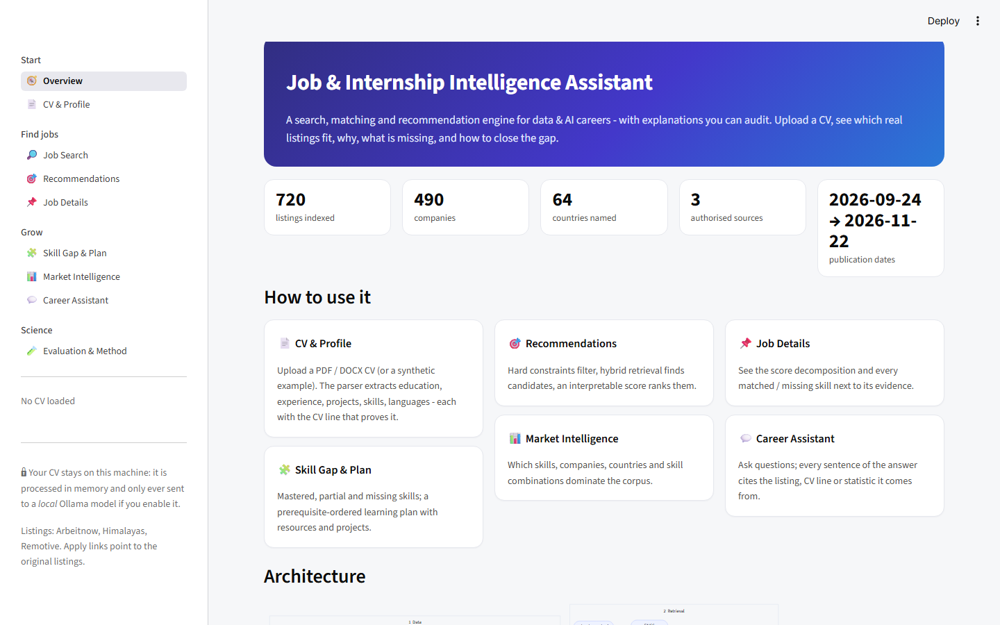

**Tu vois** : le volume de données (offres, entreprises, pays, sources, dates), le mode d'emploi en six cartes, le
schéma d'architecture, la répartition par source et par famille de métier, la provenance des données.

**Derrière** : `JobIntelService.status()` lit les offres structurées (`data/processed/jobs_enriched.jsonl`). Le
schéma est un graphe Graphviz généré dans la page. Code : `src/job_intel/ui/views/overview.py`.

**À dire** : « Le LLM n'est qu'une composante à la fin. Avant lui il y a une vraie chaîne d'IR et de matching, chacune
mesurée séparément. »

---

## 2. CV & Profile — du fichier au profil structuré

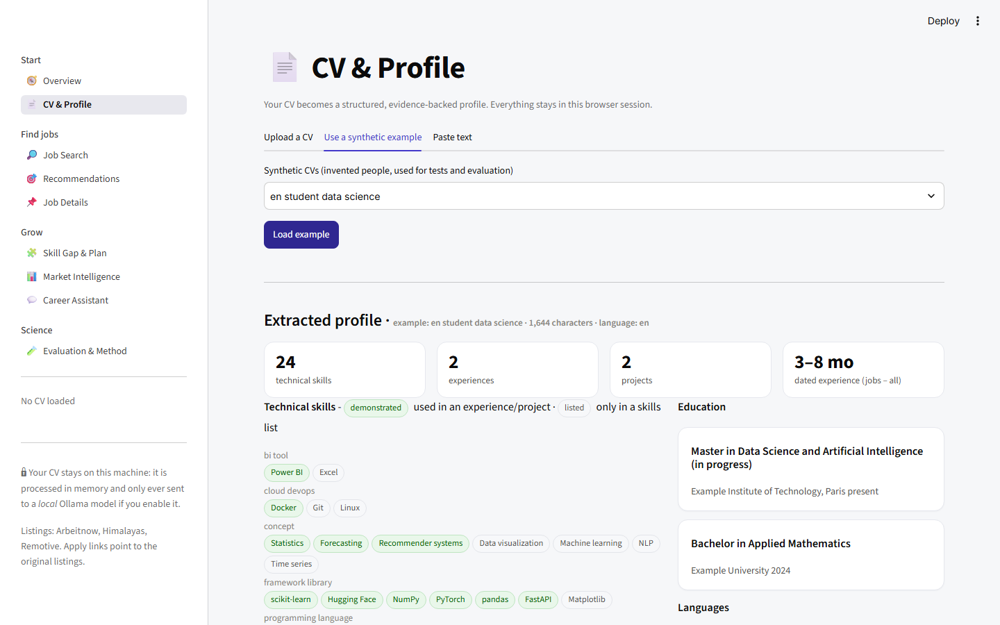

**Tu vois** : l'import (PDF / DOCX / TXT, exemple synthétique ou texte collé) ; le profil extrait : compétences par
catégorie (vert = *démontrée* dans une expérience/projet, gris = *listée*), expériences datées, projets, formation,
langues, certifications, secteurs d'expérience, soft skills ; la preuve de chaque compétence ; le JSON brut ; puis
le formulaire de **préférences** et de **contraintes éliminatoires**.

**Derrière** : `match/cv_text.py` (lecture, détection de PDF scanné), `match/cv_parser.py` (sections FR/EN/DE,
dates → bornes de durée, diplômes, langues), `match/taxonomy.py` (~150 compétences + alias). Rien n'est inféré :
pas de niveau de maîtrise, pas de coordonnées. Chapitre : [3](learn/03_cv_competences.md).

**À dire** : « *PostgreSQL implique SQL, mais SQL n'implique pas PostgreSQL* : j'ai distingué synonymes, implications
orientées et compétences voisines. »

---

## 3. Job Search — cinq moteurs de recherche

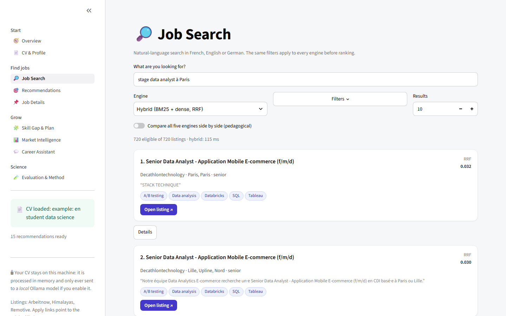

**Tu vois** : une recherche en langage naturel (FR/EN/DE), le choix du moteur, des filtres d'éligibilité, des cartes
avec extrait pertinent, compétences et lien d'origine. Le bouton « comparer les cinq moteurs » les montre côte à côte :

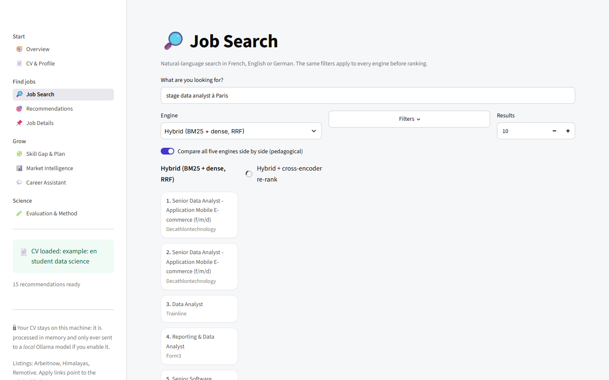

**Derrière** : mots-clés → BM25 (IDF, saturation, normalisation de longueur) → dense (e5 multilingue + FAISS exact)
→ hybride (Reciprocal Rank Fusion des rangs) → re-ranking par cross-encoder (attention croisée requête/passage).
Code : `src/job_intel/search/`. Chapitre : [2](learn/02_recherche.md).

**À dire** : « RRF fusionne des **rangs**, pas des scores : BM25 (0 à 30) et cosinus (0,8 à 0,9) ne sont pas comparables. »

---

## 4. Recommendations — éliminer d'abord, classer ensuite

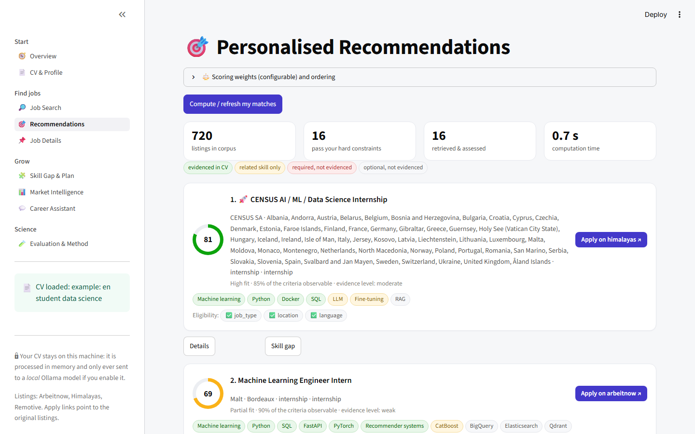

**Tu vois** : combien d'offres passent tes contraintes, des cartes avec un **anneau de compatibilité** (0–100), la
couverture des critères, les compétences colorées (attestée / voisine / requise manquante / optionnelle manquante),
le statut de chaque contrainte (✅ satisfaite, ⛔ violée, ❔ inconnue), le lien de candidature. En dépliant : les
**poids** modifiables en direct et la liste des offres **exclues avec leur raison**.

**Derrière** : `match/matcher.py` (contraintes avant la recherche, requêtes multiples issues du CV, fusion RRF) puis
`match/scoring.py` : `score = 100·Σwᵢcᵢ/Σwᵢ` sur les critères **observables**, tri par
`couverture·score + (1−couverture)·50`. Chapitre : [4](learn/04_matching_score.md).

**À dire** : « Ce n'est pas une probabilité d'embauche : aucune donnée d'embauche n'a été observée, donc rien ne
permet de calibrer vers cet événement. C'est un indice de compatibilité explicable. »

---

## 5. Job Details — pourquoi ce score ?

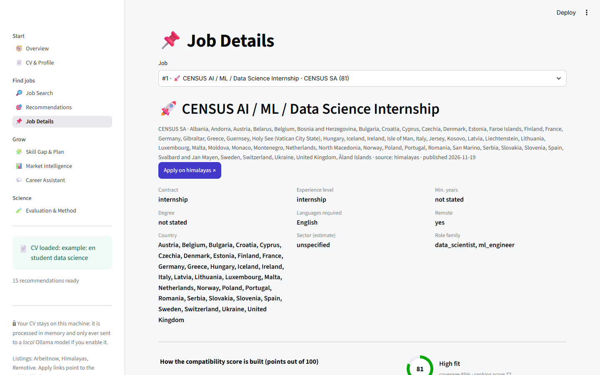

**Tu vois** : les champs structurés de l'offre, un **graphique en cascade** qui décompose le score (combien de points
apporte chaque critère), le tableau des composantes, chaque compétence avec *ce que dit l'offre* et *ce que dit ton
CV*, l'éligibilité, puis une **explication fondée** (déterministe ou LLM local) dont chaque affirmation cite un
extrait `CV…` / `JOB…`, et les affirmations supprimées par le vérificateur.

**Derrière** : `CompatibilityScore.contribution()` ; `rag/evidence.py` (paquet de preuves) ; `rag/explain.py`
(génération + vérification). Chapitre : [7](learn/07_rag.md).

---

## 6. Skill Gap & Plan — ce qui manque et dans quel ordre l'apprendre

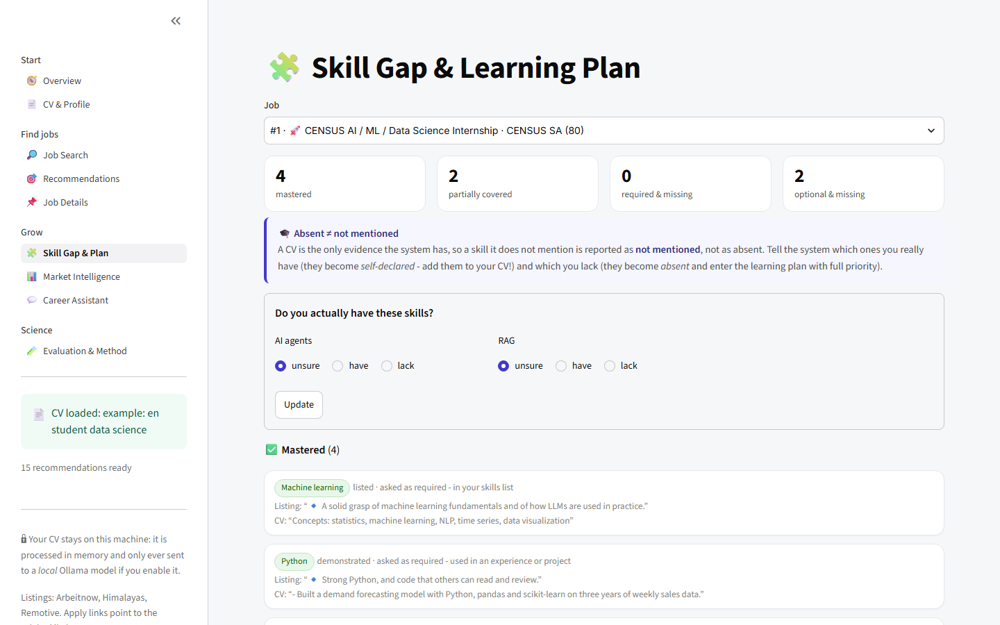

**Tu vois** : compétences maîtrisées, partiellement couvertes, manquantes requises, manquantes optionnelles — chacune
avec la ligne de l'offre et la ligne du CV ; un formulaire « **j'ai / je n'ai pas** » pour les compétences non
mentionnées ; le **plan d'apprentissage** ordonné (priorité, prérequis, ressources, projet de portfolio) ; des
questions d'entretien pour l'offre.

**Derrière** : `match/gap.py` — 7 statuts ; priorité = Σ poids du niveau × adéquation de l'offre × (1 + demande
marché) ; ordre par **tri topologique** (algorithme de Kahn) sur le graphe de prérequis de
`knowledge/skills_kb.yaml`. Chapitre : [5](learn/05_gap_plan.md).

**À dire** : « À partir du seul CV, on ne peut pas savoir si une compétence est *absente* ou *non mentionnée* ; le
système ne fait pas semblant : il le signale et te le demande. »

---

## 7. Market Intelligence — le marché vu par le corpus

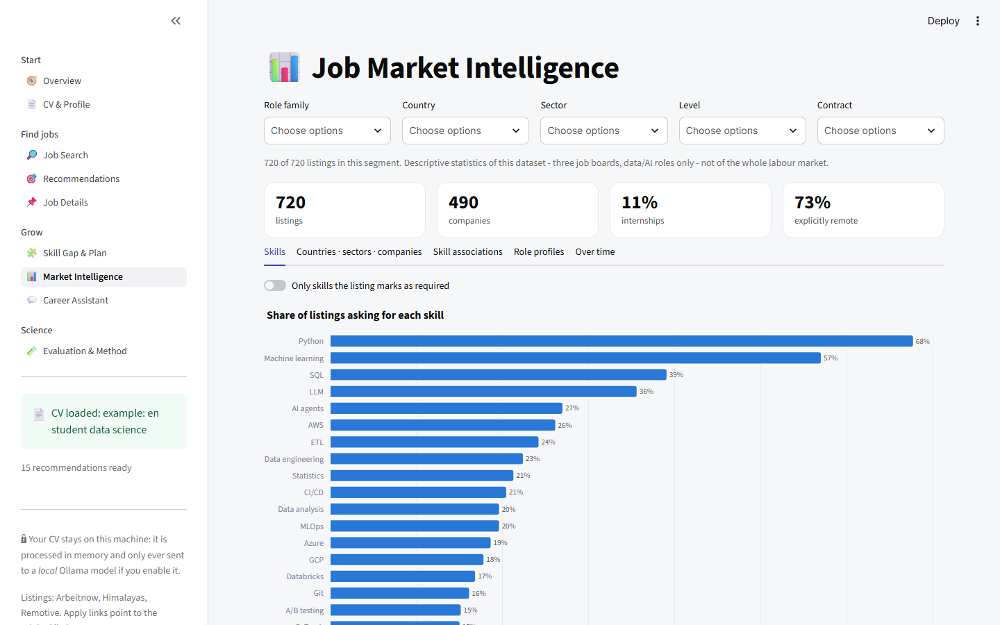

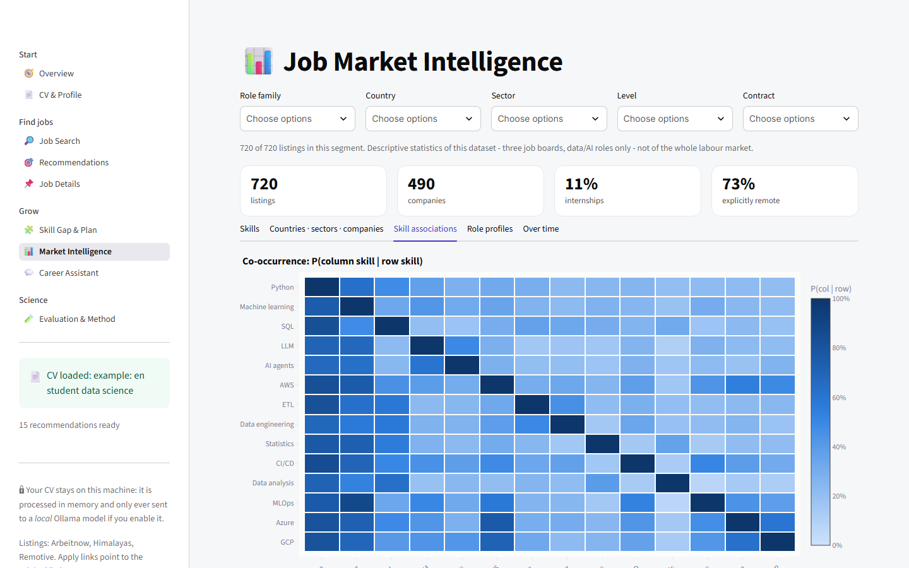

**Tu vois** : des filtres de segment (métier, pays, secteur, niveau, contrat), la demande par compétence (toutes ou
seulement requises), les soft skills, les pays, les secteurs, les entreprises, une **heatmap P(B | A)**, le tableau
des associations par **lift**, les profils de compétences par métier (**distinctivité**), l'évolution par semaine et
la comparaison de deux instantanés.

**Derrière** : `market/analytics.py` (fonctions pandas pures, testées). Chapitre : [6](learn/06_marche.md).

**À dire** : « Ce sont des statistiques de **ce jeu de données** (3 job boards, métiers data/IA), pas du marché du
travail ; Himalayas est remote et très américain, d'où la domination des États-Unis. »

---

## 8. Career Assistant — un RAG qui cite et se vérifie

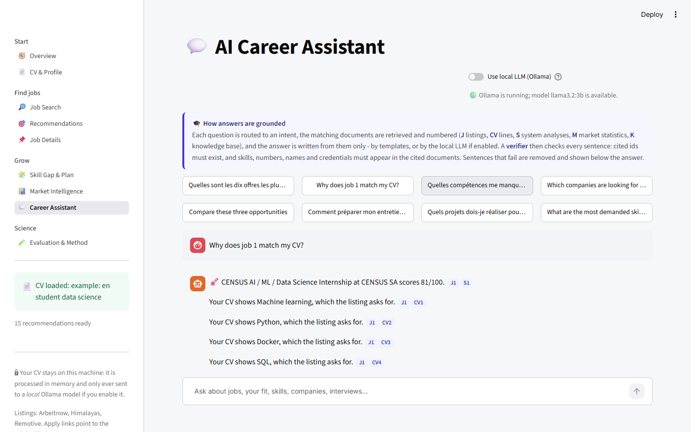

**Tu vois** : des questions suggérées (FR/EN), une conversation où chaque phrase porte ses citations
(`J1` offre, `CV2` ligne du CV, `S1` analyse calculée, `M1` statistique, `K1` base de connaissances), l'intention
détectée, le mode (déterministe / LLM local / repli), la latence, les sources dépliables et les phrases supprimées
par le vérificateur.

**Derrière** : `assistant/router.py` (9 intentions, règles), `assistant/chat.py` (documents numérotés, gabarits,
appel LLM contraint par schéma JSON, vérification phrase par phrase), `rag/ollama.py` (refuse tout serveur non local).

**À dire** : « Même les nombres ont une source : un score affiché vient d'un document d'analyse `S`. Sans lui, mon
propre vérificateur rejetait "92/100" — et il avait raison. »

---

## 9. Evaluation & Method — la science derrière

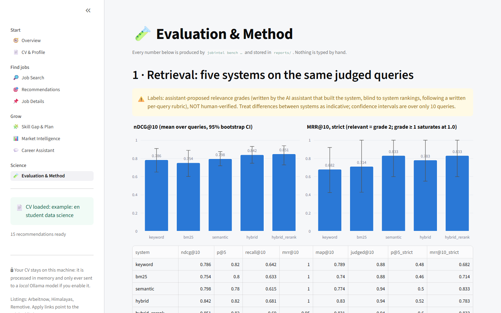

**Tu vois** : les résultats des benchmarks avec intervalles de confiance, en lisant directement `reports/*.json` :
cinq moteurs de recherche, extraction de compétences (dev avant/après, test), classement du matching, assistant,
latence. Chaque section rappelle d'où viennent les labels.

**Derrière** : `src/job_intel/evaluation/` (métriques implémentées à la main et testées, pooling, bootstrap,
leave-one-out). Chapitre : [8](learn/08_evaluation.md).

---

## 10. Ce que ce projet démontre (pour un recruteur)

| Compétence | Où le montrer |
|---|---|
| Recherche d'information | BM25 codé à la main, FAISS, RRF, cross-encoder, comparaison mesurée |
| NLP appliqué | extraction à sections, taxonomie multilingue, embeddings multilingues |
| Systèmes de recommandation | contraintes éliminatoires, score explicable, calibration LOCO |
| RAG / LLM | documents citables, vérificateur, défense contre l'injection, LLM local |
| Évaluation | nDCG/MAP/MRR/P@k/F1, pooling, bootstrap, dev/test, biais déclarés |
| Ingénierie | architecture en couches, API typée, UI, 530+ tests, CI, Docker, confidentialité |
| Honnêteté scientifique | labels non humains déclarés, sur-apprentissage détecté et refusé, limites écrites |

Préparation de l'entretien : [chapitre 10](learn/10_entretien.md).
