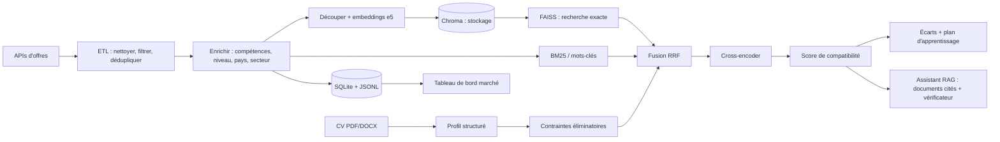

# Cours : comprendre le projet de A à Z

Ce dossier explique **chaque brique** du projet comme un cours : le problème qu'elle résout, l'idée, les
mathématiques, l'implémentation (avec les fichiers à ouvrir), comment on la mesure, ses limites, et les
questions qu'un recruteur peut poser. Lis-le dans l'ordre la première fois ; ensuite, chaque chapitre se lit seul.

| # | Chapitre | Ce que tu sauras expliquer |
|---|---|---|
| 1 | [Le problème et les données](01_donnees.md) | sources autorisées, ETL, déduplication, enrichissement, SQLite, qualité des données |
| 2 | [Recherche d'information](02_recherche.md) | mots-clés, BM25, embeddings, cosinus, FAISS vs HNSW, RRF, cross-encoder |
| 3 | [CV et compétences](03_cv_competences.md) | parsing déterministe, taxonomie, synonymes vs implications, démontré vs listé |
| 4 | [Matching et score](04_matching_score.md) | critères éliminatoires, score interprétable, couverture, calibration leave-one-out |
| 5 | [Écarts de compétences et plan](05_gap_plan.md) | « absent » vs « non mentionné », priorité, tri topologique |
| 6 | [Intelligence du marché](06_marche.md) | parts de demande, lift, distinctivité, biais d'échantillon |
| 7 | [Assistant RAG](07_rag.md) | routage, documents citables, vérificateur, hallucinations, injection de prompt, confidentialité |
| 8 | [Évaluation scientifique](08_evaluation.md) | nDCG, MAP, MRR, P@k, pooling, bootstrap, dev/test, lecture honnête des résultats |
| 9 | [Architecture et MLOps](09_architecture.md) | couches, API, UI, tests, CI/CD, Docker, configuration, sécurité |
| 10 | [Préparer l'entretien](10_entretien.md) | pitch, questions probables et réponses, chiffres clés, limites à assumer |

Le **rapport illustré** (captures d'écran de chaque page) : [../RAPPORT_PEDAGOGIQUE.md](../RAPPORT_PEDAGOGIQUE.md).
Les **résultats chiffrés** : [../../reports/evaluation_report.md](../../reports/evaluation_report.md) (généré, jamais écrit à la main).

## La carte en une image

## Trois idées qui traversent tout le projet

1. **Tout ce qui est affiché a une preuve.** Une compétence « attestée » pointe vers la ligne du CV ; une exigence
   pointe vers la ligne de l'offre ; une phrase de l'assistant cite ses documents. C'est ce qui rend le système
   auditable — et défendable en entretien.
2. **Inconnu ≠ non.** Une offre qui ne précise pas le contrat n'est pas « incompatible » ; un CV qui ne mentionne
   pas Docker ne prouve pas que tu ne connais pas Docker. Le code distingue partout *satisfait / violé / inconnu*.
3. **On mesure avant d'affirmer.** Chaque affirmation de qualité vient d'un benchmark reproductible, avec ses
   intervalles de confiance et ses biais écrits noir sur blanc (étiquettes non humaines, petits échantillons).
